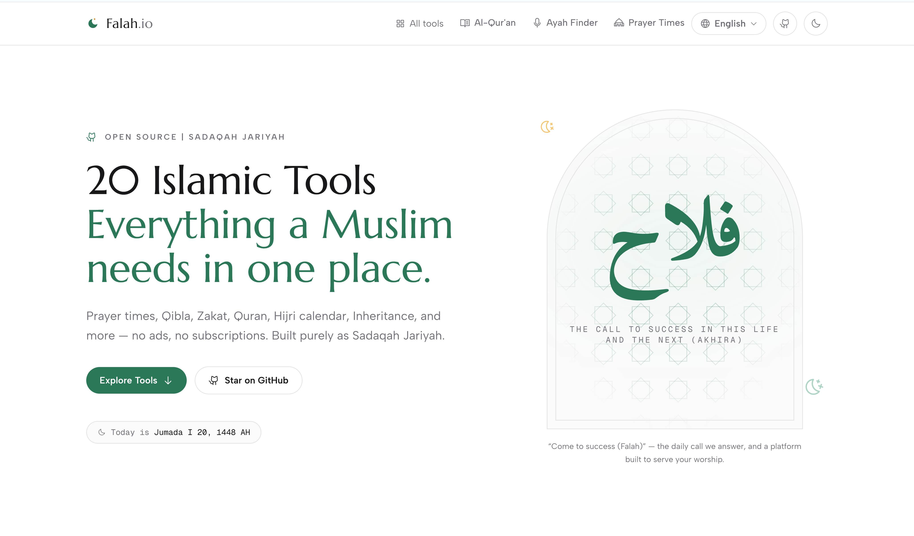
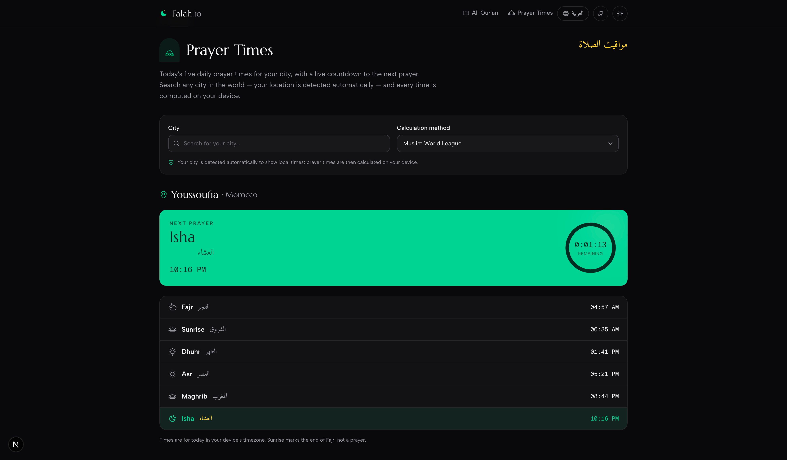
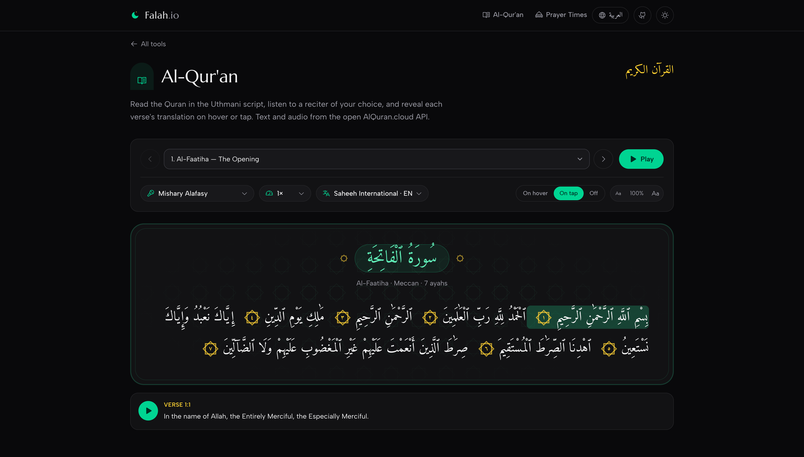
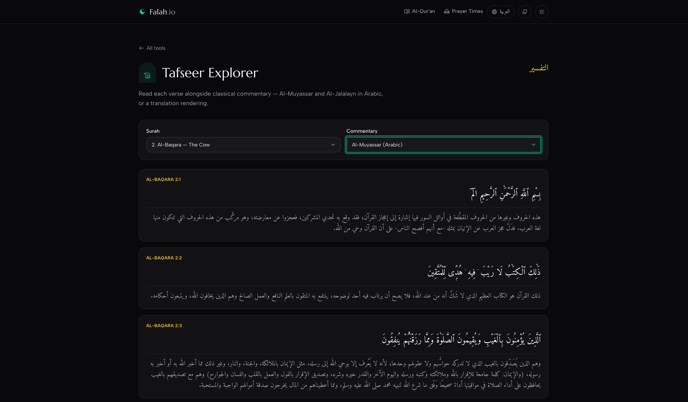
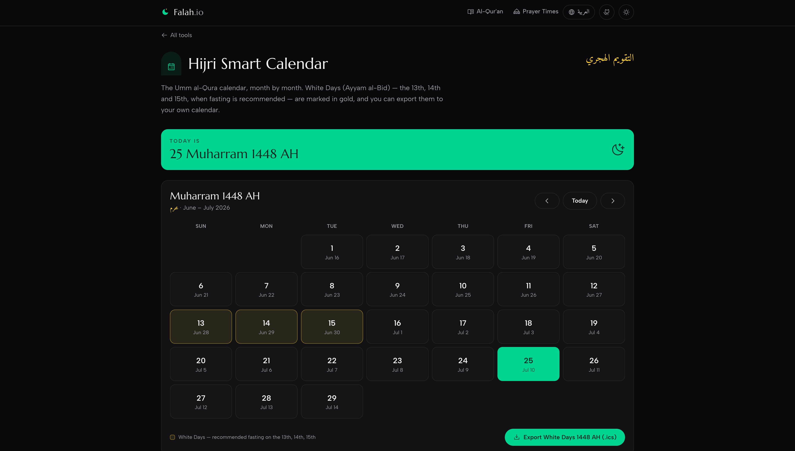

<div align="center">

<a href="https://falah.io"></a>

# Falah.io

**Open-source Islamic tools: prayer times, Quran, hadith, Qibla, Hijri calendar, Zakat and more.**<br>
No ads, no accounts, no paywall. Built as sadaqah jariyah.

<sub><i>"Come to success." Five times a day the adhan calls it. The project is named after that call.</i></sub>

<br><br>

[](https://falah.io)
[](https://github.com/abdessamadbettal/falah/actions/workflows/ci.yml)
[](LICENSE)
[](https://github.com/abdessamadbettal/falah/stargazers)
[](https://nextjs.org)
[](https://www.typescriptlang.org)
[](CONTRIBUTING.md)

[**Open the app**](https://falah.io) · [Tools](#the-tools) · [Privacy](#what-leaves-your-browser) · [Run locally](#run-it-locally) · [Contribute](#contributing) · [Report a bug](https://github.com/abdessamadbettal/falah/issues/new/choose)

<br>

<picture>
  <source media="(prefers-color-scheme: dark)" srcset=".github/screenshot/home.png">
  
</picture>

</div>

---

Most Islamic apps want something from you: an account, your location history, a subscription, or your attention for ads. Falah.io asks for none of it. It is a set of 20 tools a Muslim reaches for every day, from prayer times to the Quran reader to the Zakat calculator. Each one is a static page that does its work in your browser.

The project is free to use, free to fork, and will stay that way.

- **Runs in your browser.** There is no Falah backend and no database. Prayer times, Qibla, Hijri dates, Zakat and inheritance are all computed on your device.
- **Works offline.** It's an installable PWA. Prayer times keep working once your location is saved.
- **Four languages.** [English](https://falah.io/en/), [العربية](https://falah.io/ar/) with a full right-to-left layout, [Français](https://falah.io/fr/) and [Bahasa Indonesia](https://falah.io/id/).
- **Sources are cited.** Every text and dataset is credited [below](#data-sources-and-credits), so you can check it.

## The tools

### Prayer and time

| Tool | What it does |
|---|---|
| [**Prayer Times**](https://falah.io/en/prayer-times/) | Fajr to Isha for your location or any of ~7,700 cities, with a live countdown, the full month's timetable, and 11 calculation methods (the default is chosen per country). |
| [**Hijri Calendar**](https://falah.io/en/hijri-calendar/) | Umm al-Qura month view with the White Days (Ayyam al-Bid) marked and `.ics` export to your calendar app. |
| [**Ramadan Countdown**](https://falah.io/en/ramadan-countdown/) | Days until Ramadan, then a daily companion once it begins. |
| [**Hijri ↔ Gregorian Converter**](https://falah.io/en/date-converter/) | Convert a date in either direction. |
| [**Tasbeeh Counter**](https://falah.io/en/tasbeeh/) | Dhikr counter with targets and presets. It vibrates on each count on phones that support it. |

### Direction

| Tool | What it does |
|---|---|
| [**Qibla Finder**](https://falah.io/en/qibla/) | Bearing to the Kaaba, computed on your device and shown on a live compass using the phone's orientation sensor. |
| [**Mosque Finder**](https://falah.io/en/mosque-finder/) | Mosques and prayer rooms near you from OpenStreetMap, with one-tap directions. |

### Quran and knowledge

| Tool | What it does |
|---|---|
| [**Quran**](https://falah.io/en/quran/) | Uthmani script, eight reciters (Alafasy, al-Husary, Abdul Basit, as-Sudais and more), verse-by-verse playback, translations, and a meaning tooltip on any ayah. Every surah and juz also has its own page, e.g. [Surah Al-Kahf](https://falah.io/en/quran/surah/al-kahf/). |
| [**Tafseer**](https://falah.io/en/tafseer/) | Tafsir al-Muyassar and Tafsir al-Jalalayn, verse by verse beside the Arabic. |
| [**Ayah Finder**](https://falah.io/en/ayah-finder/) | Type or say a fragment of Arabic and get the verse it belongs to. |
| [**Hadith Collections**](https://falah.io/en/hadith/) | 36,000+ hadiths from the six books, the Muwatta and three Forty Hadith collections. Arabic with English, plus the gradings of al-Albani, Zubair Ali Zai, Shu'ayb al-Arna'ut and others. |
| [**99 Names of Allah**](https://falah.io/en/names-of-allah/) | Each name in Arabic with transliteration, meaning, a short explanation and its evidence from the Quran and Sunnah. |
| [**Hisnul Muslim**](https://falah.io/en/hisnul-muslim/) | The duas and adhkar of *Fortress of the Muslim*, by occasion, with audio. |
| [**Khatam Planner**](https://falah.io/en/quran-planner/) | Choose the day you want to finish the Quran and see how many pages that means per day and per prayer. |
| [**Umrah Simulator**](https://falah.io/en/umrah/) | A 3D walk through Tawaf and Sa'i, with the dua for each stage. |

### Calculators

| Tool | What it does |
|---|---|
| [**Zakat Calculator**](https://falah.io/en/zakat/) | Cash, gold, silver, investments and business assets, checked against a nisab (85 g gold or 595 g silver) priced from live metal rates. |
| [**Inheritance (Fara'id)**](https://falah.io/en/inheritance/) | Divides an estate by the fixed Quranic shares and the residuary heirs. |
| [**Hijri Age**](https://falah.io/en/hijri-age/) | Your age in Hijri years and the date of your next Hijri birthday. |

### Create

| Tool | What it does |
|---|---|
| [**Quran Cards**](https://falah.io/en/quran-cards/) | Turn a verse into a shareable image, with colour palettes, auto-sized text and an optional translation. |
| [**Date Stamp**](https://falah.io/en/date-stamp/) | Arabic letterhead date lines in Hijri and Gregorian for letters and documents. |

<details>
<summary><b>More screenshots</b></summary>
<br>

| Prayer times | Quran |
|---|---|
|  |  |
| **Tafseer** | **Hijri calendar** |
|  |  |

</details>

## What leaves your browser

"Private" is easy to claim, so here is exactly what happens. Falah has no server of its own: the site is static files on a CDN. Some tools fetch data from open public APIs, directly from your browser:

| When you… | Request goes to | What it carries |
|---|---|---|
| open Prayer Times or Qibla for the first time | [ipwho.is](https://ipwho.is), then [GeoJS](https://geojs.io) as fallback | your IP address, to guess a starting city |
| tap "use my location" | [BigDataCloud](https://www.bigdatacloud.com) reverse geocoding | your coordinates, to name the city |
| search for a city | [Open-Meteo](https://open-meteo.com) geocoding | what you typed |
| use Mosque Finder | [Overpass API](https://overpass-api.de) and OpenStreetMap tiles | the map area you're looking at |
| fetch live gold and silver prices in Zakat | [exchange-api](https://github.com/fawazahmed0/exchange-api) | your currency code, nothing else |
| read or listen in the Quran, Tafseer or Hisnul Muslim tools | [AlQuran.cloud](https://alquran.cloud), [Islamic Network CDN](https://islamic.network), [hisnmuslim.com](https://www.hisnmuslim.com) | the surah or chapter you opened |
| speak into Ayah Finder | your browser's speech recognition (Chrome sends the audio to Google) | your voice, only while the mic is on |

Your amounts in the Zakat and inheritance calculators are never sent anywhere. Your saved location stays in your browser's local storage.

The public site at falah.io runs Google Analytics to count page views. A fork or self-hosted copy runs **no analytics at all** unless you set `NEXT_PUBLIC_GA_ID`.

## A note on religious accuracy

These tools help with worship. They don't replace scholars, and they don't replace your local mosque.

- **Prayer times** are astronomical calculations. Pick the method your community follows. If your mosque's timetable differs, follow your mosque.
- **Hijri dates** follow the Umm al-Qura calendar. Ramadan and Eid depend on the moon sighting where you live and can differ by a day.
- **Zakat and inheritance** results apply the standard rulings. For a real estate, or an unusual family situation, confirm with a qualified scholar before acting.
- **Hadith grades** are shown as the named graders gave them. Falah does not grade hadith.
- **Translations** of the Quran convey its meanings. They are not the Quran.

Found a mistake in a ruling, a translation or a time? Please [open an issue](https://github.com/abdessamadbettal/falah/issues/new/choose). These reports matter more than any feature request.

## Run it locally

You need **Node.js 20+** and npm (pnpm and yarn also work).

```bash
git clone https://github.com/abdessamadbettal/falah.git
cd falah
npm install
npm run dev          # http://localhost:3000
```

The first `npm run dev` takes a few minutes. A pre-step downloads the Quran, hadith and GeoNames city data into git-ignored caches (`.quran-cache/`, `.hadith-cache/`, `.cities-cache/`). Later runs read from disk and need no network.

| Command | What it does |
|---|---|
| `npm run dev` | Dev server (webpack) with the data caches warmed first |
| `npm run build` | Static export to `out/`, ready for any static host |
| `npm run lint` | ESLint |
| `npx tsc --noEmit` | Type check (CI runs this with lint and build) |

> **Heads-up:** a full `npm run build` prerenders tens of thousands of pages (every surah, hadith book, country and city in four languages). Expect it to take a while and to need several GB of free disk.

**Environment variables** (both optional):

| Variable | Default | Purpose |
|---|---|---|
| `NEXT_PUBLIC_SITE_URL` | `https://falah.io` | Base for canonicals, sitemaps and structured data. Set it on a fork. |
| `NEXT_PUBLIC_GA_ID` | *(empty)* | Google Analytics ID. Leave empty for no analytics. |

## How it's built

| | |
|---|---|
| **Framework** | [Next.js 16](https://nextjs.org) App Router with `output: "export"`: no server, no API routes, no middleware |
| **UI** | React 19, [Tailwind CSS 4](https://tailwindcss.com), [Motion](https://motion.dev), [Iconify](https://iconify.design) |
| **Prayer and Qibla maths** | [adhan](https://github.com/batoulapps/adhan-js) |
| **3D** | [three.js](https://threejs.org) via React Three Fiber and Drei (Umrah simulator) |
| **Offline** | [Serwist](https://serwist.pages.dev) service worker, installable PWA |
| **Hosting** | Any static host. falah.io runs on Vercel. |

```text
app/
  [locale]/          one route tree for /en, /ar, /fr and /id; each tool is page.tsx + client.tsx
  (redirect)/        "/" picks your language; old unprefixed URLs forward to /en
  sitemap-*.xml/     split sitemaps: site, prayer countries and cities, names, quran, hadith
components/          shared UI, one component per file under ui/
content/             long-form guides and the 99 Names explanations, as markdown per language
lib/                 tool registry, SEO and JSON-LD builders, prayer, quran and hadith logic
locales/<lang>/      UI strings, typed against English so a missing key fails the build
scripts/             build-time data fetchers and integrity checks
```

<details>
<summary><b>Prerendered pages and URL structure</b></summary>
<br>

Besides the interactive tools, the reference content is prerendered as plain HTML pages, so it can be read and indexed without JavaScript. Every page has its own title, description, canonical, `hreflang` and schema.org data. Slugs are committed to the repo, so a URL never shifts because an upstream dataset renamed something.

| Route | Pages per language | Indexed |
|---|---|---|
| `/quran/surah/[slug]` | 114 | yes |
| `/quran/juz/[n]` | 30 | yes |
| `/quran/hizb/[n]` · `/quran/page/[n]` | 60 · 604 | no: reading views over the same verses, `noindex, follow` |
| `/hadith/[collection]` | 10 | yes |
| `/hadith/[collection]/[book]` (+ `/part-n` past 50 hadiths) | ~1,060 | English and Arabic only, the languages the text exists in |
| `/names-of-allah/[name]` | 99 | yes |
| `/prayer-times/[country]` | ~244 | yes |
| `/prayer-times/[country]/[city]` | ~7,700 | ~1,700: cities over 300k people that aren't districts of a larger city, plus each country's largest |

The thresholds live in `lib/places.ts`, `lib/quran-seo.ts` and `lib/hadith-seo.ts`. Pages outside the index still render, so anyone looking for their own town gets a timetable.

</details>

## Data sources and credits

Falah stands on open data and on the people who maintain it. May Allah reward them.

| Data | Source |
|---|---|
| Quran text (Uthmani), translations and tafsir | [AlQuran.cloud](https://alquran.cloud) API |
| Recitation audio | [Islamic Network CDN](https://islamic.network) |
| Hadith text, English translation and grades | [fawazahmed0/hadith-api](https://github.com/fawazahmed0/hadith-api) |
| Arabic hadith book titles (cross-checked against the above) | [AhmedBaset/hadith-json](https://github.com/AhmedBaset/hadith-json) |
| Hisnul Muslim duas and audio | [hisnmuslim.com](https://www.hisnmuslim.com) |
| Prayer time and Qibla calculation | [batoulapps/adhan-js](https://github.com/batoulapps/adhan-js) |
| Cities, coordinates and timezones | [GeoNames](https://www.geonames.org), CC BY 4.0 |
| Mosques and map tiles | © [OpenStreetMap](https://www.openstreetmap.org/copyright) contributors, ODbL |
| Gold and silver prices | [fawazahmed0/exchange-api](https://github.com/fawazahmed0/exchange-api) |

## Contributing

Contributions of every size are welcome. Some of the most useful ones aren't code:

- **Check the religious content.** Duas, translations, rulings and explanations of the Names. Corrections with a source are gold.
- **Translate.** A new language is mostly one folder under `locales/`. Use the [translation request](https://github.com/abdessamadbettal/falah/issues/new?template=translation.yml) template to start.
- **Report bugs.** Wrong prayer times for your city are worth an issue, so include the city and the method you expected.
- **Build.** Fix an issue, improve accessibility, or add a tool. The [contributing guide](CONTRIBUTING.md) covers setup, the pre-PR checklist and a step-by-step recipe for adding a new tool or language.

Please read the [Code of Conduct](CODE_OF_CONDUCT.md). Report security issues privately as described in [SECURITY.md](SECURITY.md).

<a href="https://github.com/abdessamadbettal/falah/graphs/contributors">
  
</a>

## Support the project

> The Prophet ﷺ said: *"When a person dies, their deeds come to an end except for three: ongoing charity, knowledge that benefits, or a righteous child who prays for them."* (Sahih Muslim 1631)

The project will stay free, open source, ad-free and without a premium tier. If it helps you, you can:

- ⭐ star the repo, which helps other Muslims find it on GitHub
- share a tool with someone who needs it
- cover hosting and domain costs on [Ko-fi](https://ko-fi.com/abdessamadbettal)

## License

The code is [MIT](LICENSE) licensed: use it, fork it, learn from it, ship your own version. The data in [Data sources](#data-sources-and-credits) stays under its own licenses.

<div align="center">
<br>
<p dir="rtl" lang="ar">رَبَّنَا تَقَبَّلْ مِنَّا ۖ إِنَّكَ أَنتَ السَّمِيعُ الْعَلِيمُ</p>
<sub><i>"Our Lord, accept this from us. You are the All-Hearing, the All-Knowing."</i> (Al-Baqarah 2:127)</sub>
</div>
